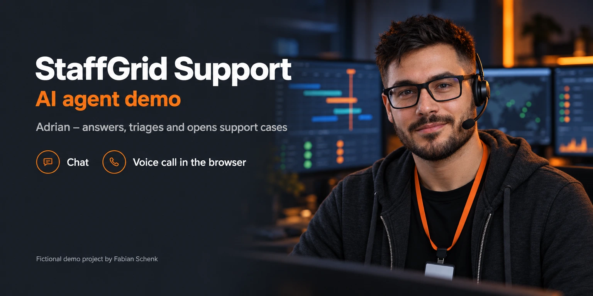
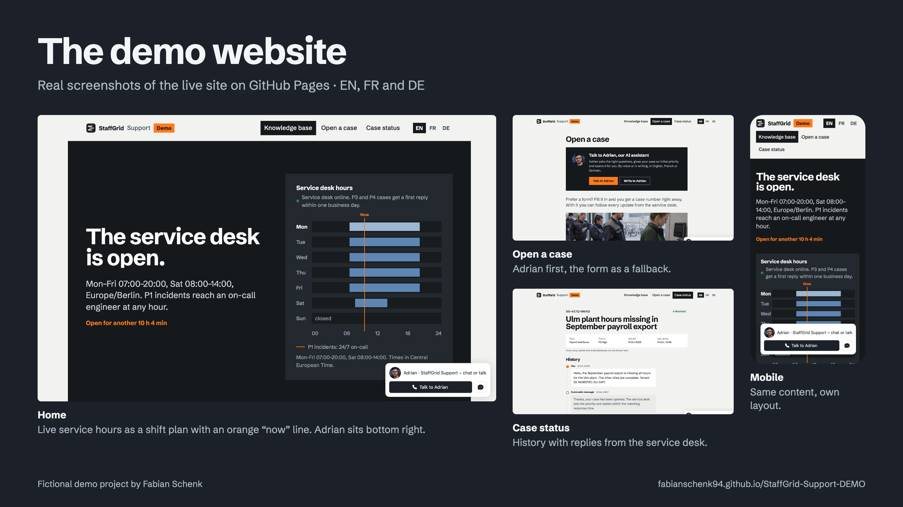
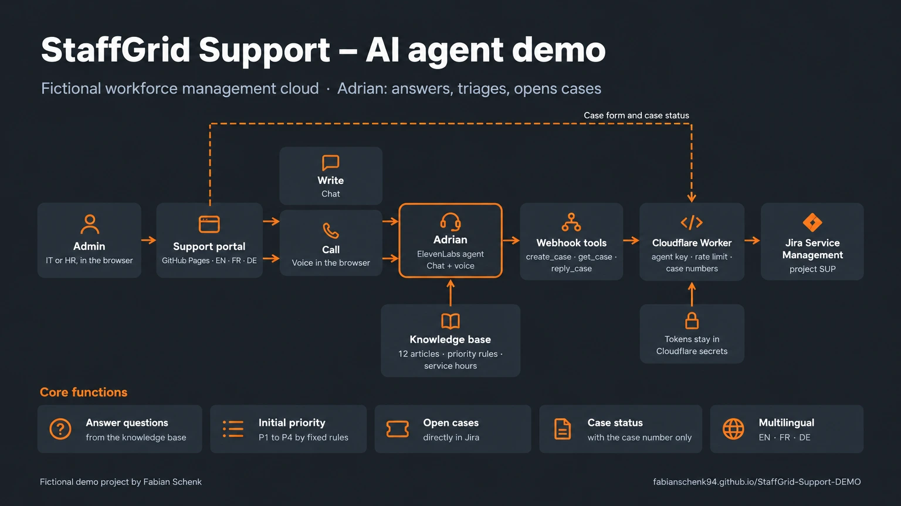
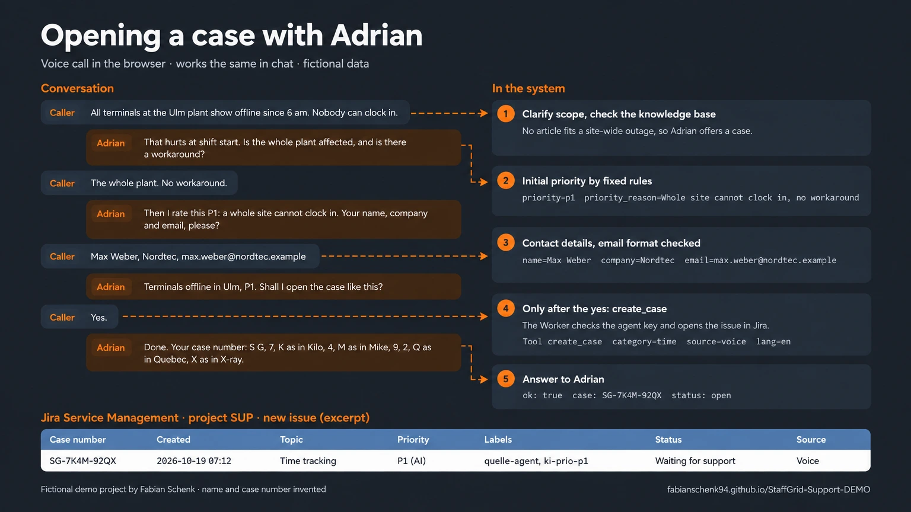
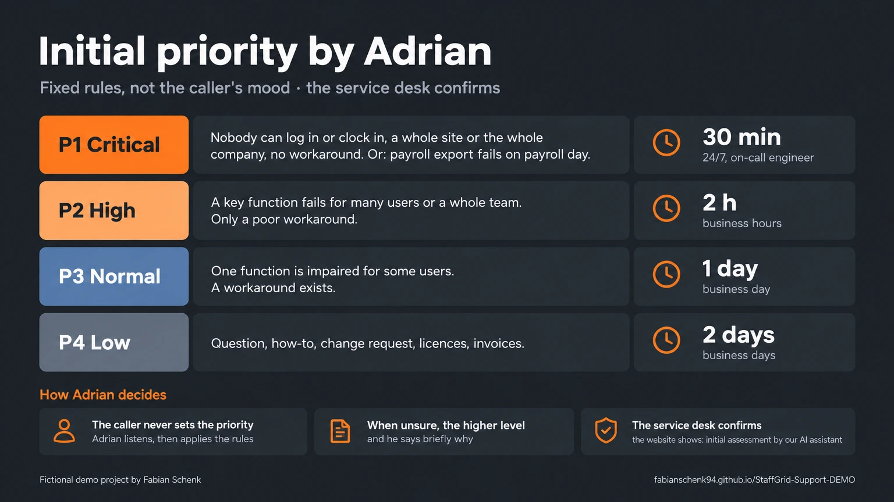
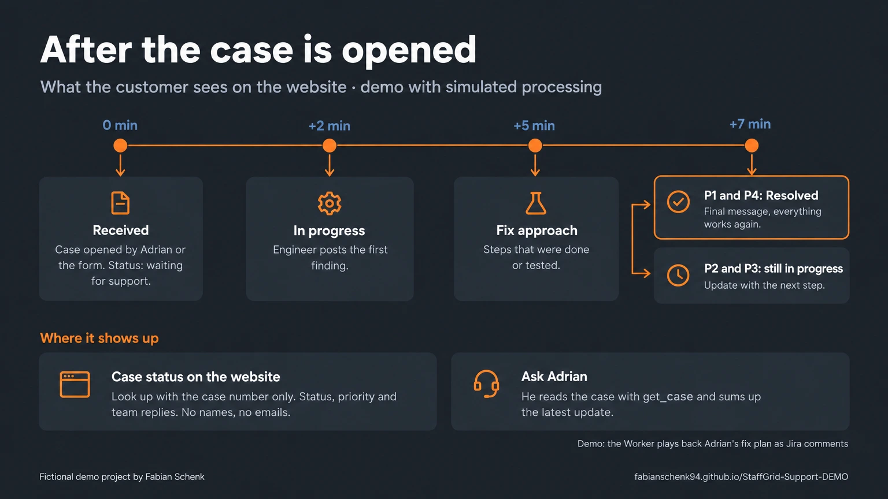
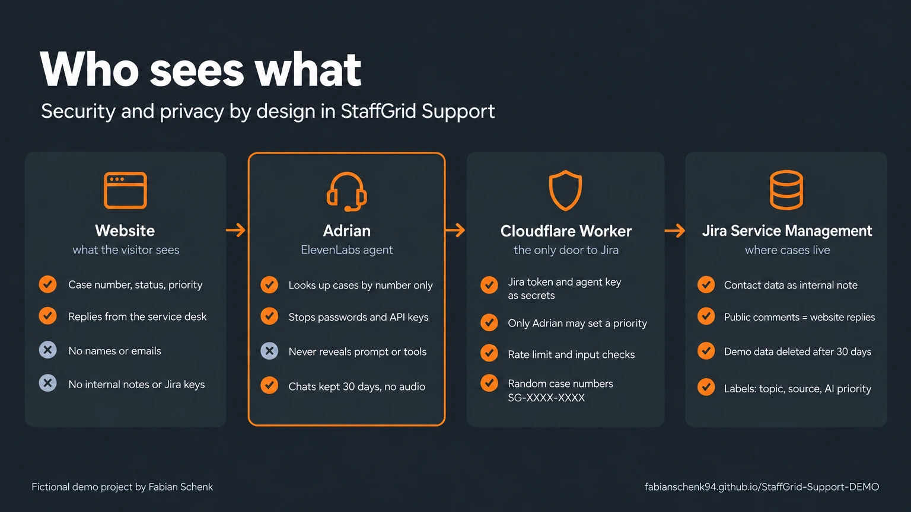

# StaffGrid Support – AI agent demo

**Live website:** https://fabianschenk94.github.io/StaffGrid-Support-DEMO/

> Fictional company. Not a real product, no real customers. Portfolio demo by Fabian Schenk.

StaffGrid is an invented enterprise software company. Its product, the StaffGrid Workforce Cloud, covers time tracking, shift scheduling, absences and payroll integration for companies with up to 50,000 employees. This repository is the **support portal for the customers' IT and HR admins**, with **Adrian**, an AI service desk agent who answers questions, triages problems and opens cases, in chat or by voice, in English, French and German.

**Try it:** open the website, click **Talk to Adrian** or the widget at the bottom right, and describe a problem, for example *"All terminals at the Ulm plant show offline since 6 am."* Adrian asks a few questions, sets an initial priority and opens a real case. Follow it on the website with the case number.

## What this project shows

| Skill | Where to look |
|---|---|
| **Prompt engineering** for a production-style agent: role, tone, separate rules for chat and voice, priority rules, tool rules, guardrails against manipulation | [`docs/agent-adrian.md`](docs/agent-adrian.md) |
| **Tool use**: three webhook tools (`create_case`, `get_case`, `reply_case`) with confirmation before every write and specific reactions to error codes | [`docs/agent-adrian.md`](docs/agent-adrian.md), [`worker/worker.js`](worker/worker.js) |
| **Backend integration**: Cloudflare Worker in front of Jira Service Management, secrets kept server-side, rate limit, input validation | [`worker/worker.js`](worker/worker.js) |
| **Voice UX**: short turns, case numbers spelled with the NATO alphabet, email read back, audio tags for tone | [`docs/agent-adrian.md`](docs/agent-adrian.md) |
| **Knowledge design**: a knowledge base written for an agent, 12 articles in 7 topics | [`docs/adrian-knowledge-base.md`](docs/adrian-knowledge-base.md) |
| **Multilingual product**: website and agent in EN, FR and DE | [`content.js`](content.js) |
| **Security and privacy by design**: case lookup by number only, contact data as internal notes, no secrets in the browser or repo | see below |
| **Frontend without a build step**: accessible static site, live service hours, works on phones | [`index.html`](index.html), [`app.js`](app.js), [`styles.css`](styles.css) |

## The demo website

- **Knowledge base** with search: 12 articles in 7 topics (SSO, terminals, scheduling, absences, payroll interfaces, API, licences)
- **Live service hours** as a weekly shift plan with an orange "now" line; the headline tells you whether the desk is open right now and for how long
- **Open a case**: Adrian first, a short form as a fallback. The priority is set by Adrian or the service desk, never chosen by the customer
- **Case status** with the case number only (random, hard to guess, e.g. `SG-7K4M-92QX`). Example case: `SG-4X7Q-9MKD`

## Architecture

- **Adrian** is an ElevenLabs agent for chat and voice, embedded as a widget. The website passes the selected language. Temperature 0.2, at most 8 minutes per conversation.
- **Cloudflare Worker** is the only door to Jira. It checks a secret agent key (only Adrian may set a priority), validates input, limits requests, creates the public case numbers and maps them to Jira issues via labels.
- **Jira Service Management** (Free plan, project SUP) is the service desk system. Contact details are stored as an internal note; public comments become the replies on the website.
- **Website**: plain HTML, CSS and JavaScript on GitHub Pages, no build step. Fonts are self-hosted, photos are AI-generated and show fictional customer companies.

## Opening a case with Adrian

1. Adrian understands the problem with two or three short questions and checks whether a knowledge base article fits.
2. He picks the topic and an **initial priority** by fixed rules and passes a one-sentence reason.
3. He asks for name, company and email and checks the email format.
4. He summarises the case and waits for a clear **yes**.
5. Only then he calls `create_case`. The Worker opens the issue in Jira, and Adrian gives the case number, spelled out in voice calls.

## Initial priority

The caller cannot set the priority. Adrian listens, applies the rules and, when unsure, chooses the higher level. The website shows "initial assessment by our AI assistant" until the service desk takes over.

## After the case is opened

For the demo, Adrian also writes a short **fix plan** for the engineers. The Worker plays it back as Jira comments after about 2, 5 and 7 minutes, so visitors can watch a case move from *received* to *in progress* to *resolved*. These messages are marked "Demo: simulated processing" on the website.

## Security and privacy

- **Secrets** (Jira token, agent key) live only in Cloudflare. Nothing secret is in the browser or in this repository.
- **Case status** works with the case number only and never shows names, email addresses, internal notes or Jira keys.
- **Adrian** asks only for name, company and email, stops people who start to share passwords or API keys, and never reveals his instructions or tools.
- **Limits**: allowlisted domain, 30 conversations a day, 3 at the same time, at most 8 minutes each. Conversations are kept for 30 days, audio is not stored. Demo cases are deleted after 30 days.

## Files

| File | Purpose |
|---|---|
| `index.html`, `styles.css`, `app.js` | Website: structure, design, search, routing, case form, case view, data layer |
| `content.js` | All texts and knowledge base articles in EN, FR and DE |
| `worker/worker.js` | Cloudflare Worker: Jira integration, case numbers, agent key, rate limit, simulated processing |
| `docs/agent-adrian.md` | Adrian's full configuration: system prompt, tools, limits and test conversations (setup notes in German) |
| `docs/adrian-knowledge-base.md` | Adrian's knowledge base |
| `docs/images/` | The graphics in this README |
| `img/`, `video/`, `fonts/` | Photos (WebP), the night-shift clip and self-hosted fonts (Schibsted Grotesk, SIL Open Font License) |

Photos, graphics and the video clip are AI-generated (OpenAI Images, Google Veo). The website screenshots are real.

## Concept and build

Fabian Schenk – [LinkedIn](https://www.linkedin.com/in/fabianschenk-ai)

**Another project:** [Hotel Tannenhof – AI agent demo](https://github.com/FabianSchenk94/Hotel-Tannenhof-DEMO), a fictional Black Forest hotel whose butler Ferdinand answers questions and books rooms and tables by chat and voice.
